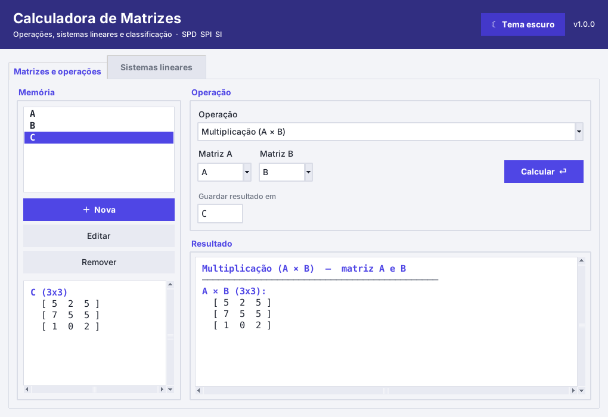
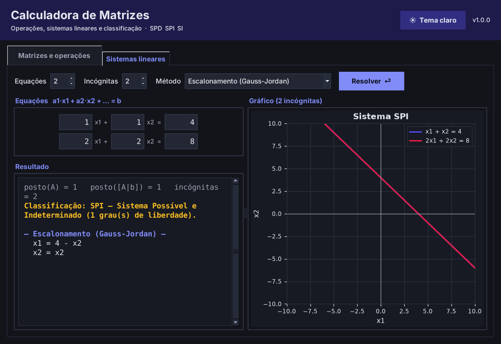
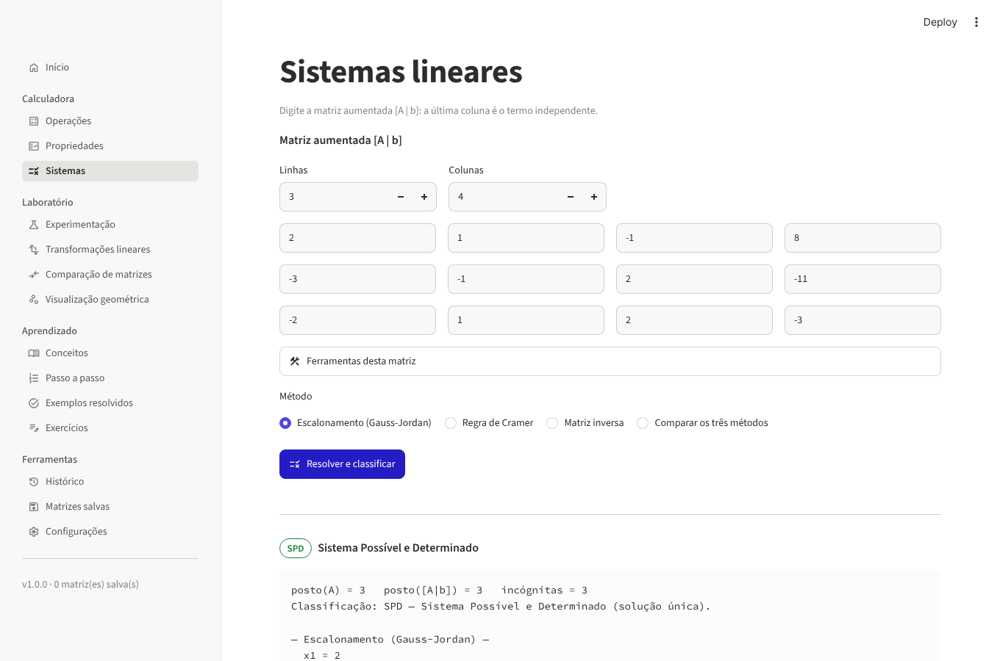

# Calculadora de Matrizes

[](https://github.com/tirolasca/calculadora-matrizes/actions/workflows/ci.yml)


Calculadora de **matrizes e sistemas lineares** com três interfaces: uma **plataforma web educacional** (Streamlit), uma **janela** (tkinter, com tema claro e escuro) e um **menu no terminal**. Resolve sistemas por escalonamento, regra de Cramer ou matriz inversa e **classifica** cada um como **SPD**, **SPI** ou **SI**.

Todas as contas usam aritmética **exata** (frações, via [SymPy](https://www.sympy.org)), sem erros de arredondamento: `1/3` continua `1/3`.

<p align="center">
  
  
</p>
<p align="center">
  
</p>

## Recursos

| Área | O que faz |
| --- | --- |
| **Memória de matrizes** | Cadastre A, B, C… e reutilize em qualquer operação; resultados podem ser guardados com um nome |
| **Operações** | soma, subtração, multiplicação, multiplicação por escalar, potência (inclusive negativa), transposta, inversa |
| **Propriedades** | determinante, posto, traço, forma escalonada reduzida (RREF), autovalores e autovetores, decomposição LU |
| **Sistemas lineares** | resolve e classifica em **SPD** (solução única), **SPI** (infinitas soluções, com a solução geral) ou **SI** (sem solução), pelo teorema de Rouché-Capelli |
| **Métodos** | escalonamento (Gauss-Jordan), regra de Cramer, matriz inversa (`x = A⁻¹·b`) ou comparar os três |
| **Gráfico** | para sistemas com 2 incógnitas, desenha as retas (e mostra se cruzam, coincidem ou são paralelas) |

A regra de Cramer e a matriz inversa só se aplicam a sistemas quadrados com `det(A) ≠ 0`. Nos demais casos o programa explica o motivo e indica o escalonamento, que resolve qualquer sistema.

Números podem ser digitados como inteiros, decimais ou frações: `3`, `-2.5`, `1/2`.

## Plataforma web (Streamlit)

Calcule, experimente, visualize e aprenda: a mesma matemática do terminal e da janela, com **passo a passo em LaTeX**, laboratório, geometria e exercícios.

<p align="center">
  
  
</p>
<p align="center">
  
  
</p>

| Grupo | Páginas |
| --- | --- |
| **Calculadora** | Operações · Propriedades e decomposições (LU, QR, Cholesky, diagonalização) · Sistemas (Gauss, Cramer, inversa) |
| **Laboratório** | Experimentação (antes/depois das propriedades, experimentos guiados) · Transformações lineares · Comparação de matrizes e propriedades algébricas · Visualização geométrica (vetores, span, autovetores) |
| **Aprendizado** | Conceitos · Passo a passo · Exemplos resolvidos · Exercícios (3 níveis, correção e solução explicada) |
| **Ferramentas** | Histórico · Matrizes salvas · Configurações (tema, exportar/importar sessão) |

```bash
pip install -e ".[web]"
calculadora-matrizes-web            # ou: streamlit run streamlit_app.py
```

Aceita frações, decimais e expressões (`1/2`, `sqrt(2)`, `2*pi`, parâmetros como `a`). Os passos mostrados são **conferidos contra o núcleo**; quando não há explicação confiável (ex.: raízes irracionais de grau 3), só o resultado é exibido.

**Publicar no Streamlit Community Cloud:** em [share.streamlit.io](https://share.streamlit.io) escolha este repositório, branch `main` e o arquivo principal `streamlit_app.py` (as dependências vêm de `requirements.txt`). Depois de publicar, coloque o link aqui: `https://<seu-app>.streamlit.app`.

## Instalação

Requer **Python 3.11 ou superior**.

```bash
git clone https://github.com/tirolasca/calculadora-matrizes.git
cd calculadora-matrizes

python -m venv .venv
source .venv/bin/activate        # Windows: .venv\Scripts\activate

pip install -e .
```

> **Linux:** o tkinter (janela) pode precisar de `sudo apt install python3-tk`.
> No Windows e no macOS ele já vem com o Python.

## Uso

```bash
calculadora-matrizes-gui            # janela (ou: python -m matrizes.gui)
calculadora-matrizes-gui --escuro   # janela já no tema escuro
calculadora-matrizes                # menu no terminal (ou: python -m matrizes)
```

Na janela: **Ctrl+Enter** executa a operação da aba atual e o botão no topo alterna entre o tema claro e o escuro.

### Exemplo: classificando um sistema

No terminal, opção `17`, e digite cada equação como os coeficientes seguidos do termo independente. O sistema

```
 2x +  y -  z =   8
-3x -  y + 2z = -11
-2x +  y + 2z =  -3
```

é digitado como `2 1 -1 8`, `-3 -1 2 -11` e `-2 1 2 -3`, e a resposta é:

```
Classificação: SPD — Sistema Possível e Determinado (solução única).
  x1 = 2
  x2 = 3
  x3 = -1
```

Exemplos de **SPI** e **SI**:

| Sistema | Classificação | Resultado |
| --- | --- | --- |
| `x + y = 2` · `2x + 2y = 4` | SPI | `x1 = 2 - x2`, com `x2` livre |
| `x + y = 2` · `x + y = 3` | SI | sem solução |

## Desenvolvimento

```bash
pip install -e ".[dev,web]"

ruff check .            # erros e estilo
ruff format .           # formatação
mypy                    # tipos (interface web)
pytest                  # testes (a janela é pulada se não houver display)
xvfb-run -a pytest      # Linux sem tela: roda também os testes da janela
```

A integração contínua (GitHub Actions, `.github/workflows/ci.yml`) roda o lint, a checagem de tipos, os testes em Linux (Python 3.11 a 3.15), Windows e macOS, e confere se o pacote é construído.

### Estrutura

```
matrizes/
├── nucleo.py   # cálculo (funções puras sobre sympy.Matrix); sem entrada/saída
├── paleta.py   # paletas claro/escuro compartilhadas
├── cli.py      # menu do terminal
├── gui.py      # janela tkinter
└── web/        # plataforma Streamlit (services/ sem UI, components/, pages/)
streamlit_app.py
tests/          # pytest: núcleo, terminal, janela e web (AppTest)
docs/           # capturas de tela e ARQUITETURA.md
```

O núcleo não imprime nem lê nada; terminal, janela e web só cuidam de entrada e exibição, e **nenhuma operação é reimplementada**. Detalhes e decisões em [`docs/ARQUITETURA.md`](docs/ARQUITETURA.md).

## Licença

[MIT](LICENSE)
